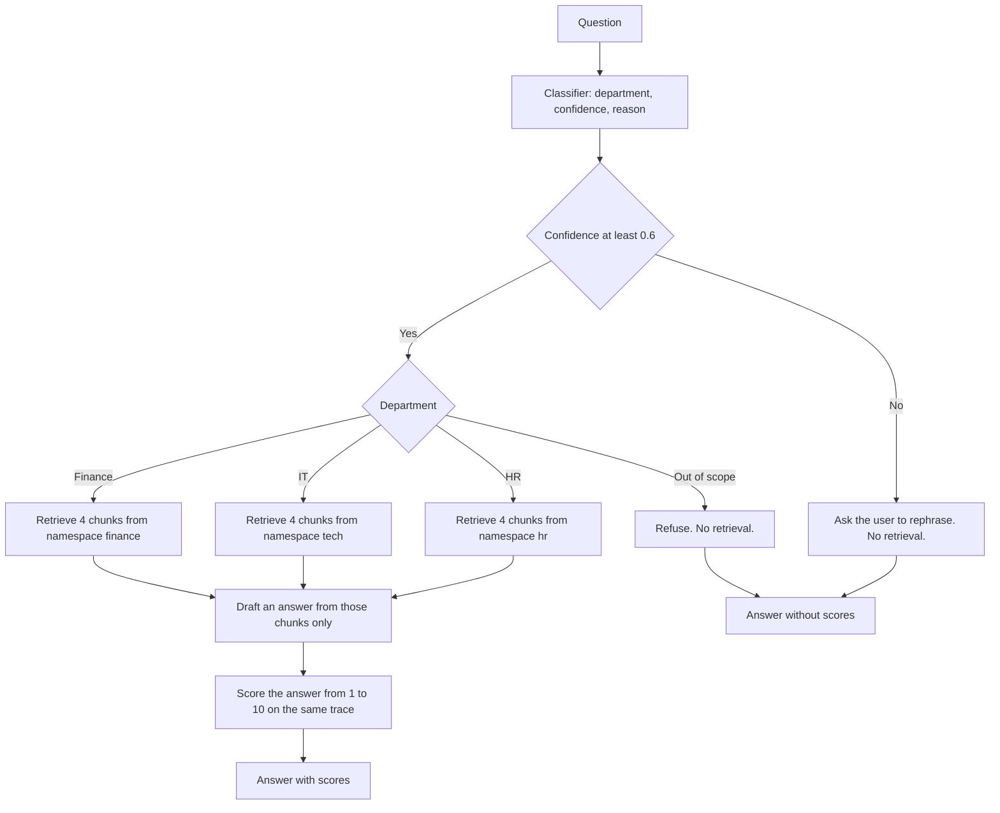

# Multi-Agent Assistant

Educational MVP (v0.1.0) for internal support questions at Nubiq, a fictional SaaS company with teams in Argentina, Chile, and Uruguay. One question enters through `answer()`. A classifier picks HR, IT, Finance, or out of scope, and the router opens a single retrieval branch.

The page, the prompts, and the policy documents are in Spanish. This README and the files under `docs/` are in English.

## Project overview

An employee asks a support question. The system does not search every policy manual. It classifies the question, retrieves four chunks from that department's Pinecone namespace, and drafts an answer from those chunks. A second model call then grades the answer. The grade is stored on the same Langfuse trace and is not written back into the answer.

Out-of-scope questions, including legal topics such as dismissal, stop before retrieval and are not graded.

```text
ui/  or  POST /api/query
        -> answer()                         src/multi_agent_system.py
        -> classifier                      src/agents/orchestrator.py
        -> confidence threshold and branch src/routing.py
        -> one RAG chain                   src/rag.py
        -> evaluator, department answers   src/agents/evaluator.py
```

Details of both flows are in [docs/architecture.md](docs/architecture.md).

## Problem statement

Internal questions arrive in one channel and are easy to send to the wrong team. Vacation policy belongs to HR. A VPN failure belongs to IT. A travel reimbursement belongs to Finance. A severance question is legal and has no agent here.

The system separates those cases before it reads any documents, then answers only from the selected collection.

## Key features

- Three RAG agents, HR, IT, and Finance, each with its own Markdown collection and Pinecone namespace.
- A structured classifier that returns a department, a confidence from 0 to 1, and a one-sentence reason.
- A confidence floor of 0.6. Below it, no retrieval branch runs.
- Answers restricted to the retrieved chunks, with the source file name in the prompt instructions.
- Langfuse tracing of classification, retrieval, generation, and evaluation on one trace named `multi_agent`.
- Four numeric scores after a department answer: relevance, completeness, accuracy, and quality, each from 1 to 10.
- `POST /api/query` and a static page served by the same FastAPI process.
- Direct commands for a single agent, without the classifier: `python -m src.agents.hr_agent`, and the same for `tech_agent` and `finance_agent`.

## Architecture overview



A vacation question takes the HR path through scoring. A dismissal question takes the out-of-scope path and does not touch Pinecone or the evaluator.

Component responsibilities, the ingest path, and the HTTP fields are documented in [docs/architecture.md](docs/architecture.md).

## Tech stack

| Concern | Choice in this repository |
| --- | --- |
| Language | Python 3.11 |
| Orchestration | LangChain 1.4.4, LCEL and `RunnableBranch` |
| Chat and embeddings | `gpt-4o-mini`, `text-embedding-3-small` via `langchain-openai` and `openai` |
| Vector store | Pinecone serverless, cosine, 1536 dimensions, namespaces `hr`, `tech`, `finance` |
| Tracing and scores | Langfuse Python SDK 4.17 |
| HTTP and page | FastAPI and a static page under `ui/` |
| Configuration | `python-dotenv` and `src/config.py` |
| Splitter | `langchain-text-splitters`, character length, not tokens |

Pinned versions are in `requirements.txt`. `langchain-community`, `tiktoken`, `jupyter`, and `ipykernel` are pinned there as well. Current modules do not import them, and this repository does not ship a notebook.

## Getting started

From the repository root:

```bash
python3 -m venv .venv
source .venv/bin/activate
pip install -r requirements.txt
cp .env.example .env
```

Fill in `.env`. Do not commit it. `.gitignore` already excludes `.env`.

`OPENAI_API_KEY` and `PINECONE_API_KEY` are required by `load_settings()`. Langfuse keys are required for traces and for the credential check. Pinecone index, cloud, and region have defaults. See [Configuration](#configuration).

Check the three accounts, preview a split, then load each namespace:

```bash
python -m src.check_credentials
python -m src.documents hr
python -m src.ingest hr
python -m src.ingest tech
python -m src.ingest finance
```

`src.documents` only prints how the Markdown was split. It still requires the two keys above because it reads settings for the chunk size. `src.ingest` creates the index when the name is missing, deletes the given namespace, and upserts it again. Pass `hr`, `tech`, or `finance`.

Ask one question from the terminal, then start the page:

```bash
python -m src.multi_agent_system "¿Cuántos días de vacaciones corresponden después de 2 años en la empresa?"
uvicorn src.api:app --reload
```

The page is [http://127.0.0.1:8000/](http://127.0.0.1:8000/). Run `uvicorn` from the repository root so `src` imports.

## Configuration

Environment variables consumed by the running system:

| Variable | Required | Role |
| --- | --- | --- |
| `OPENAI_API_KEY` | Yes | Embeddings and chat completions. |
| `PINECONE_API_KEY` | Yes | Vector index. |
| `LANGFUSE_PUBLIC_KEY` | For traces | Langfuse public key. Read by the SDK, not by `load_settings()`. |
| `LANGFUSE_SECRET_KEY` | For traces | Langfuse secret key. |
| `LANGFUSE_BASE_URL` | For traces | Langfuse host. The SDK also accepts `LANGFUSE_HOST`. `.env.example` sets both to `https://cloud.langfuse.com`. |
| `PINECONE_INDEX` | No | Index name. Default `multi-agent-assistant`. |
| `PINECONE_CLOUD` | No | Used only when the index is created. Default `aws`. |
| `PINECONE_REGION` | No | Used only when the index is created. Default `us-east-1`. |

These knobs are attributes of `Settings` in `src/config.py`. They are not environment variables.

| Knob | Current value | Effect of a change |
| --- | --- | --- |
| `route_confidence_threshold` | `0.6` | Questions below this value skip retrieval. Applies on the next question. |
| `retriever_k` | `4` | How many chunks the generator sees. Applies on the next question. |
| `chunk_size`, `chunk_overlap` | `800`, `120` | How Markdown is cut. Re-ingest the namespace afterward. |
| `chat_model` | `gpt-4o-mini` | Classifier, generator, and evaluator. |
| `embedding_model`, `embedding_dimensions` | `text-embedding-3-small`, `1536` | A different dimension needs a new Pinecone index. The existing index is not rebuilt automatically. |

Policy text lives in `data/hr_docs/`, `data/tech_docs/`, and `data/finance_docs/`. After an edit, run `python -m src.ingest` for that domain.

To add a department, for example Legal:

1. Add Markdown files under `data/legal_docs/`.
2. Add `legal` to `DOMAINS` in `src/config.py`.
3. Add a system prompt module, following `src/agents/hr_agent.py`: answer only from retrieved context and cite the file.
4. Register the prompt in `PROMPTS` and add a branch to `RunnableBranch` in `src/routing.py`.
5. Add `legal` to the `Department` literal and to the classifier instructions in `src/agents/orchestrator.py`.
6. Add a label in `LABELS` in `ui/app.js`.
7. Run `python -m src.ingest legal`.

## Example usage

Terminal, full router:

```bash
python -m src.multi_agent_system "¿Cuántos días de vacaciones corresponden después de 2 años en la empresa?"
```

One department, no classifier and no scores:

```bash
python -m src.agents.tech_agent "No puedo conectarme a la VPN desde casa. ¿Qué reviso primero?"
```

HTTP:

```bash
curl -s http://127.0.0.1:8000/health
curl -s http://127.0.0.1:8000/api/query \
  -H 'Content-Type: application/json' \
  -d '{"query":"¿Cuántos días de vacaciones corresponden después de 2 años en la empresa?"}'
```

`test_queries.json` lists 12 questions and the department each one is expected to take: HR, IT, Finance, and out of scope. Nothing in the repository executes that file. It is a manual checklist.

The page has four example buttons: vacation, VPN, reimbursement, and dismissal. They fill the text area. They do not submit until you press the button.

Screenshot files are not in the tree yet. The reserved names and what each capture should show are listed in [docs/images/README.md](docs/images/README.md).

## Technical design decisions

The short form is below. Tradeoffs are written out in [docs/design-decisions.md](docs/design-decisions.md).

- **LCEL and `RunnableBranch`.** One pipeline, one branch per question, named steps in the trace. Not a free tool-calling loop.
- **One Pinecone index, three namespaces.** Retrieval cannot cross departments. Markdown in `data/` is re-ingested by replacing the namespace.
- **800 / 120 chunks and k = 4.** The cut stays large enough for a policy paragraph. Extra source files were added instead of shrinking the chunk size.
- **`gpt-4o-mini` at temperature 0 and `text-embedding-3-small`.** Repeated checks stay comparable, at a low cost.
- **Confidence floor of 0.6.** Uncertain questions do not open a branch.
- **FastAPI plus a static page.** The endpoint and the page are two clients of `answer()`.
- **The evaluator runs after the answer.** It writes Langfuse scores and does not change the text. Out-of-scope questions are not scored.

## Known limitations

- The evaluator does not score out-of-scope answers.
- There is no conversation memory. Each question is independent.
- The local API has no authentication.
- Ingest, questions, and evaluation spend OpenAI credit. Pinecone stores the vectors.
- The confidence value is the classifier's own number. The 0.6 floor is not a measured calibration.
- Retrieval always returns four chunks. A weak match is still passed to the generator. The prompt tells the model to admit a gap.
- `build_router()` constructs all three department chains even though one branch runs.
- `python -m src.documents` requires API keys in the environment and does not call the APIs.
- `test_queries.json` is not an automated suite.

## Roadmap

v0.1.0 is the educational MVP: three agents, conditional routing, Pinecone namespaces, Langfuse traces, scores, a local API, and a page.

Not done in this version, and not required to understand or run it:

- Add the screenshots listed in [docs/images/README.md](docs/images/README.md).
- Choose a license. See the recommendation in the repository discussion; no license file is included yet.
- Add offline unit tests for the confidence threshold, the two refusal messages, and the confidence validator. v0.1.0 does not include them.
- Later, if the demo grows: conversation memory, authentication on the API, or another department agent using the steps in [Configuration](#configuration).

## Documentation map

| Document | Contents |
| --- | --- |
| [docs/architecture.md](docs/architecture.md) | Ingest flow, query flow, modules, trace names, HTTP fields. |
| [docs/design-decisions.md](docs/design-decisions.md) | Why the main choices were made, and what they rule out. |
| [docs/images/README.md](docs/images/README.md) | Screenshot filenames reserved for a later commit. |
