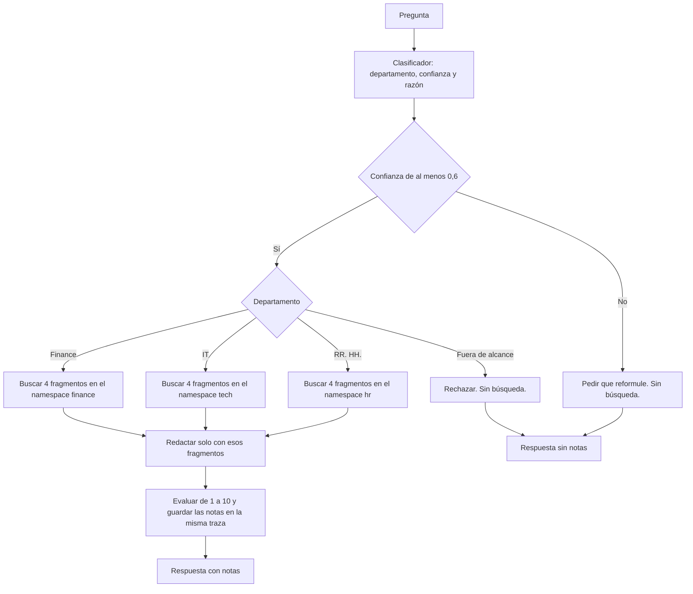

# Asistente multiagente de soporte interno

Sistema de routing para consultas internas de Nubiq, una empresa SaaS ficticia. Una pregunta entra por `answer()`. El orquestador elige RR. HH., IT, Finance o fuera de alcance, y el router abre una sola rama RAG.

## Recorrido de una pregunta

La pantalla y `POST /api/query` llaman a la misma función. Langfuse registra todo el camino en una traza llamada `multi_agent`.



Vacaciones baja por RR. HH. hasta la nota. Un despido sale por «Fuera de alcance» y no toca Pinecone ni el evaluador.

## El sistema

1. Las políticas viven en `data/hr_docs/`, `data/tech_docs/` y `data/finance_docs/`.
2. Cada carpeta se parte en chunks y se convierte en embeddings.
3. Los vectores quedan en los namespaces `hr`, `tech` y `finance` del índice de Pinecone.
4. El clasificador devuelve departamento, confianza y una razón.
5. Si la confianza es menor a 0,6, no se abre ninguna rama.
6. El agente elegido recupera 4 chunks de su namespace y redacta solo con eso.
7. Langfuse registra la clasificación, la búsqueda, la generación y las notas del evaluador en la misma ejecución.
8. `POST /api/query` expone esa función por HTTP. La pantalla en `/` muestra el departamento, la razón, la evaluación y los fragmentos.

## Decisiones técnicas

- **LangChain con LCEL y `RunnableBranch`.** El flujo es una tubería con una bifurcación. El clasificador devuelve un objeto `RouteDecision` (departamento, confianza, razón) y el router abre una sola rama. Esos pasos quedan con nombre en la traza: `orchestrator`, `rag_hr`, `rag_tech`, `rag_finance`.
- **Una colección de Pinecone por departamento.** Los namespaces `hr`, `tech` y `finance` viven en el mismo índice. La búsqueda de un agente no entra en los vectores de otro.
- **Chunks de 800 caracteres con 120 de solapamiento, y 4 fragmentos por respuesta.** El corte conserva el sentido de una política. Si un dominio no llega a 50 chunks, se agregan documentos en lugar de achicar el corte.
- **`gpt-4o-mini` con temperatura 0 y `text-embedding-3-small`.** La clasificación y las respuestas se mantienen estables entre pruebas, con un coste bajo.
- **Confianza mínima de 0,6.** Por debajo de ese umbral no se abre ninguna rama y se pide reformular la pregunta.
- **FastAPI y una página estática.** El endpoint traduce HTTP a `answer()`. La pantalla es otro cliente de esa misma función.
- **El evaluador corre después de la respuesta.** Puntúa relevancia, completitud, exactitud y una nota general de 1 a 10, y las escribe en la traza con la Score API de Langfuse. No modifica el texto que ve quien preguntó. Una consulta fuera de alcance no se puntúa, porque no hubo respuesta RAG.

## Requisitos

- Python 3.11
- Cuentas de OpenAI, Langfuse y Pinecone

## Instalación

```bash
python3 -m venv .venv
source .venv/bin/activate
pip install -r requirements.txt
cp .env.example .env
```

Completá `.env` con tus claves. No lo subas al repositorio.

## Ejecución

Desde la raíz del proyecto, con el entorno activo:

```bash
python -m src.check_credentials
python -m src.documents hr
python -m src.ingest hr
python -m src.ingest tech
python -m src.ingest finance
python -m src.multi_agent_system "¿Cuántos días de vacaciones corresponden después de 2 años en la empresa?"
uvicorn src.api:app --reload
```

Con el servidor levantado, la pantalla está en [http://127.0.0.1:8000/](http://127.0.0.1:8000/). La misma pregunta por HTTP:

```bash
curl -s http://127.0.0.1:8000/health
curl -s http://127.0.0.1:8000/api/query \
  -H 'Content-Type: application/json' \
  -d '{"query":"¿Cuántos días de vacaciones corresponden después de 2 años en la empresa?"}'
```

`src.documents` solo muestra cómo quedó partido el texto. `src.ingest` crea el índice si no existe y carga el namespace que se le pasa (`hr`, `tech` o `finance`). Volver a correr la ingesta borra ese namespace y lo carga de nuevo.

## Configuración

| Variable | Uso |
| --- | --- |
| `OPENAI_API_KEY` | Embeddings `text-embedding-3-small` y respuestas `gpt-4o-mini` |
| `LANGFUSE_PUBLIC_KEY`, `LANGFUSE_SECRET_KEY`, `LANGFUSE_BASE_URL` | Trazas en Langfuse Cloud |
| `PINECONE_API_KEY` | Base vectorial |
| `PINECONE_INDEX` | Nombre del índice. Por defecto `multi-agent-assistant` |
| `PINECONE_CLOUD`, `PINECONE_REGION` | Dónde se crea el índice si todavía no existe. Por defecto `aws` / `us-east-1` |

Los Markdown de `data/` son la fuente. Pinecone guarda el índice derivado.

## Qué se puede cambiar

Los valores de abajo son los que usa el sistema hoy. Cambiarlos no rearma el proyecto.

| Ajuste | Valor actual | Dónde |
| --- | --- | --- |
| Umbral de confianza | 0,6 | `route_confidence_threshold` en `src/config.py` |
| Fragmentos por respuesta (top k) | 4 | `retriever_k` en `src/config.py` |
| Tamaño de chunk y solapamiento | 800 y 120 | `chunk_size` y `chunk_overlap` en `src/config.py` |
| Modelo de respuesta y de embeddings | `gpt-4o-mini`, `text-embedding-3-small` | `chat_model` y `embedding_model` en `src/config.py` |
| Políticas de un equipo | los Markdown de esa carpeta | `data/hr_docs/`, `data/tech_docs/` o `data/finance_docs/` |

El umbral y el top k aplican en la próxima pregunta. Un cambio de chunk, o un Markdown editado, pide volver a ingestar ese namespace: `python -m src.ingest hr` (o `tech`, o `finance`). Si el modelo de embeddings cambia de dimensión, el índice de Pinecone hay que crearlo de nuevo: el actual es de 1536.

Para sumar un agente, por ejemplo Legal:

1. Crear `data/legal_docs/` con sus Markdown.
2. Agregar `legal` a `DOMAINS` en `src/config.py`.
3. Escribir el prompt en `src/agents/legal_agent.py`, con las mismas reglas que los otros: responder solo con el contexto y citar el archivo.
4. Sumar ese prompt a `PROMPTS` y una rama en el `RunnableBranch` de `src/routing.py`.
5. Sumar `legal` al tipo `Department` y al texto del clasificador en `src/agents/orchestrator.py`.
6. Sumar la etiqueta en `LABELS` de `ui/app.js`.
7. Cargar el namespace con `python -m src.ingest legal`.

`python -m src.agents.hr_agent` (y lo mismo con `tech_agent` y `finance_agent`) habla con un solo agente, sin pasar por el clasificador.

## Límites

- El evaluador no puntúa las consultas fuera de alcance.
- No hay memoria de la conversación anterior. El endpoint local no tiene autenticación.
- Cada ingesta, cada pregunta y cada evaluación consumen créditos de OpenAI. Pinecone almacena los vectores.
