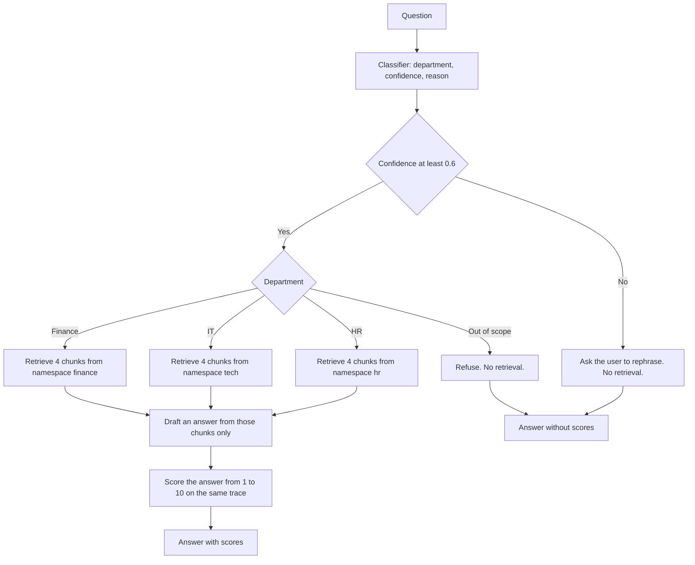
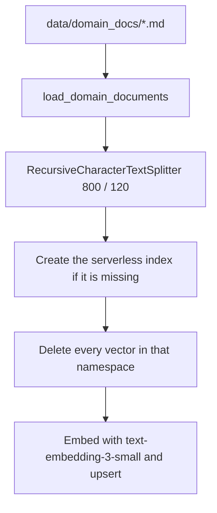

# Architecture

Nubiq is a fictional SaaS company. This service answers one internal support question at a time. It classifies the question, opens one department branch, and answers from that department's documents.

The page and `POST /api/query` both call `answer()` in `src/multi_agent_system.py`. There is no second routing implementation.

User-facing copy, prompts, and policy documents are in Spanish. Module names and API fields are in English.

## Query flow

`build_router()` constructs the classifier and all three RAG chains when `answer()` starts. `RunnableBranch` invokes only the matching branch. The other chains stay idle for that question.

A confidence below `0.6` rewrites the routed department to `out_of_scope` before the branch. `refuse()` then chooses the rephrase text. A confident legal or unrelated question uses the other refusal text. Both cases return `department: "out_of_scope"`, an empty `sources` list, and `scores: null`.

## Ingest flow

Markdown under `data/` is the source of truth. Pinecone stores the derived index.

`python -m src.ingest hr` (or `tech`, or `finance`) runs that path for one domain:

1. `load_domain_documents` reads every `*.md` file in `data/<domain>_docs/`. Metadata starts as the file name.
2. `split_documents` cuts the text with `chunk_size` 800 and `chunk_overlap` 120. Each chunk keeps `source`, `domain`, and `start_index`.
3. `ensure_index` creates `multi-agent-assistant` only when that index name does not exist. The index is cosine similarity, 1536 dimensions, serverless `aws` / `us-east-1` unless the environment overrides the cloud and region.
4. `clear_namespace` deletes all vectors in the target namespace. A missing namespace is ignored.
5. `add_documents` upserts the chunks with stable SHA-1 ids and `async_req=False`.

Running ingest again replaces that namespace. It does not update the other namespaces. Editing a Markdown file has no effect until that domain is ingested again. `ensure_index` does not rebuild an index that already exists, including one created with a different dimension.

`python -m src.documents hr` prints the file count, the chunk count, and a sample. It still calls `load_settings()`, so `OPENAI_API_KEY` and `PINECONE_API_KEY` must be present even though this command does not call those APIs.

The repository currently contains 12 Markdown files in `data/hr_docs/`, 14 in `data/tech_docs/`, and 14 in `data/finance_docs/`.

## Component responsibilities

| Piece | Module | Responsibility |
| --- | --- | --- |
| Page | `ui/index.html`, `ui/app.js`, `ui/styles.css` | Sends `POST /api/query` and renders department, confidence, reason, answer, scores, and excerpts. |
| HTTP API | `src/api.py` | Maps JSON to `answer()` and back. It does not classify or retrieve. |
| Entry point | `src/multi_agent_system.py` | Builds the router, attaches a Langfuse callback, calls the evaluator for department answers, then flushes the client. |
| Classifier | `src/agents/orchestrator.py` | One structured model call. Returns `RouteDecision`: `department`, `confidence`, `reason`. Run name `orchestrator`. |
| Router | `src/routing.py` | Applies the confidence threshold and opens one branch. Run name `router`. |
| Shared RAG chain | `src/rag.py` | Similarity search with scores, then a grounded generation call. Run names `retriever`, `generation`, and `rag_hr`, `rag_tech`, or `rag_finance`. |
| Department prompts | `src/agents/hr_agent.py`, `tech_agent.py`, `finance_agent.py` | Spanish instructions for one namespace. Each module can also answer without the classifier. |
| Evaluator | `src/agents/evaluator.py` | Scores relevance, completeness, accuracy, and quality from 1 to 10. Writes numeric Langfuse scores. Run name `evaluator`. |
| Documents | `src/documents.py` | Loads Markdown and splits it. |
| Ingest | `src/ingest.py` | Rebuilds one namespace. |
| Vector store | `src/vectorstore.py` | Pinecone client, index creation, namespace delete, and the LangChain store. |
| Settings | `src/config.py` | Paths, model names, chunk size, top k, and the confidence threshold. |
| Credential check | `src/check_credentials.py` | Calls OpenAI, Langfuse, and Pinecone with the keys in `.env`. |

## What each department is allowed to answer

The classifier prompt assigns the department before any retrieval:

- `hr`: leave, benefits, onboarding, performance, conduct, working hours, and the people record.
- `tech`: VPN, passwords, devices, Wi-Fi, access tickets, and a portal that does not open.
- `finance`: reimbursements, per diem, invoices, the corporate card, payroll dates, and travel expense caps.
- `out_of_scope`: legal topics such as severance and dismissal, and questions that are not about the company.

If a question mixes system access with a policy, access wins. "I cannot open the payroll portal" is `tech`. "When is payroll paid?" is `finance`.

Each department prompt tells the model to use only the retrieved context, cite the file name, and say when the documents do not cover the question. HR must not calculate severance, give VPN steps, or prepare a travel reimbursement. IT must not give vacation days, reimbursement amounts, or pay dates. Finance must not give vacation days or VPN steps.

## Trace names

One call to `answer()` is one Langfuse trace named `multi_agent`. Inside it, the names above mark the classifier, the router, the selected RAG chain, retrieval, generation, and, for a department answer, the evaluator.

The evaluator joins that trace with `trace_context={"trace_id": handler.last_trace_id}` and then calls `create_score`. The comment is stored on the `quality` score. `relevance`, `completeness`, and `accuracy` are numeric scores on the same trace. `get_client().flush()` runs before `answer()` returns.

Direct commands such as `python -m src.agents.hr_agent` call `answer_department`. They retrieve and generate, and they flush a trace, but they do not classify and they do not score.

## HTTP contract

`GET /` returns `ui/index.html`. Static files are mounted at `/static`.

`GET /health` returns `{"status": "ok"}`.

`POST /api/query` accepts `{"query": "<non-empty string>"}`. An empty string fails Pydantic validation. The response body is:

| Field | Meaning |
| --- | --- |
| `answer` | Spanish text shown to the user. |
| `department` | `hr`, `tech`, `finance`, or `out_of_scope`. |
| `confidence` | Number from 0 to 1 returned by the classifier. |
| `reason` | One Spanish sentence from the classifier, plus the threshold sentence when confidence was too low. |
| `sources` | Up to four objects with `source`, `excerpt` (at most 500 characters), and `score`. Empty when no branch ran. |
| `scores` | `relevance`, `completeness`, `accuracy`, `quality`, and `comment`. `null` when `department` is `out_of_scope`. |

The cosine `score` is retrieval closeness. A higher value is closer. It is not the evaluator grade.
